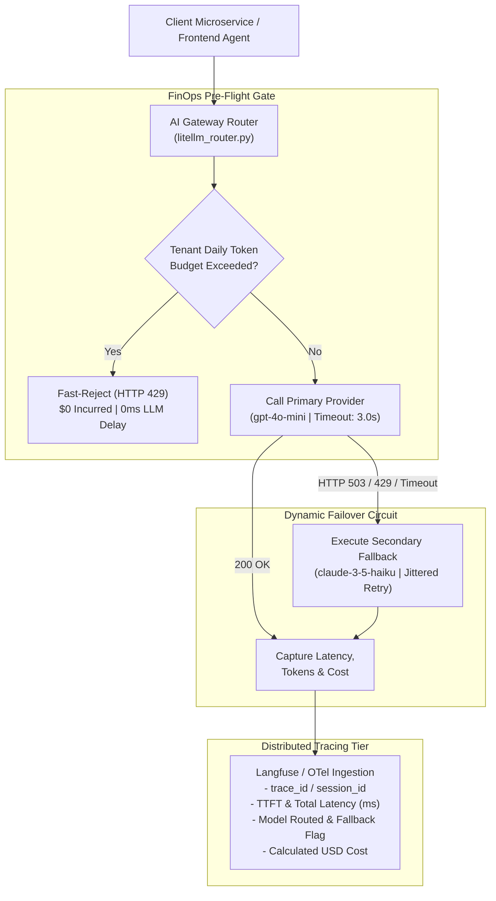

# Production LLM Observability & LiteLLM Gateway

[](https://github.com/BerriAI/litellm)
[](https://langfuse.com/)
[]()
[]()

Production-grade AI Gateway and LLM routing service engineered to eliminate model vendor lock-in, guarantee 99.99% availability through automated multi-provider failover (OpenAI $\leftrightarrow$ Anthropic), enforce client-side token budgets, and stream distributed OpenTelemetry/Langfuse telemetry events for financial-grade audit compliance.

---

## 📖 1. Why Company Platforms Need an AI Gateway

Directly calling `openai.OpenAI()` or `anthropic.Anthropic()` in production microservices creates critical enterprise risks:

1. **Vendor Lock-in & Outage Vulnerability:** If OpenAI experiences a 503 outage or rate limit (HTTP 429), your trading assistant or compliance pipeline crashes unless you have automated fallback to Anthropic Claude or AWS Bedrock.
2. **FinOps Risk (Runaway Costs):** Without centralized token budgeting, a single looping agent or malicious user can burn thousands of dollars in API credits in minutes.
3. **Regulatory Audit Compliance (BaFin):** Financial institutions must log every prompt, completion, token count, model version, and latency metric for auditability and compliance.

---

## 🏗️ 2. Architectural Diagram: The LiteLLM Gateway Pattern



---

## ⚡ Core Platform Capabilities

| Capability | Technical Implementation | Enterprise Benefit |
| :--- | :--- | :--- |
| **Multi-Provider Failover** | Automatic cascading from `gpt-4o-mini` to `claude-3-5-haiku` | Guarantees business continuity during provider outages (HTTP 503/429) |
| **FinOps Token Guardrails** | Pre-call budget threshold checks per user/tenant ID | Prevents runaway API bills and recursive agent loops from draining capital |
| **Strict SLA Timeouts** | Non-blocking asynchronous I/O with granular 3.0-second timeouts | Prevents cascading connection pool exhaustion and sluggish user interfaces |
| **Zero Vendor Lock-in** | Standardized OpenAI-compatible schema across 100+ LLMs | Swap models via YAML configuration without altering downstream microservices |
| **Full-Stack Observability** | Distributed trace metadata matching Langfuse / OpenTelemetry specs | Auditability of prompts, completions, token usage, and costs for regulatory compliance |

---

## 📊 Observability Telemetry Schema

Every request emits a structured, immutable JSON telemetry payload:

```json
{
  "trace_id": "trace-8f2c31e0b4a1",
  "user_id": "usr_alex_101",
  "session_id": "session-4a12df90",
  "status": "SUCCESS",
  "primary_model": "gpt-4o-mini",
  "routed_model": "claude-3-5-haiku",
  "fallback_triggered": true,
  "latency_ms": 78.4,
  "usage": {
    "prompt_tokens": 45,
    "completion_tokens": 32,
    "total_tokens": 77
  },
  "cost_usd": 0.000205,
  "cumulative_tenant_spend_usd": 0.000229,
  "tags": ["fintech-assistant", "production-routing", "model:claude-3-5-haiku"]
}
```

---

## 🚀 Quickstart & Standalone Demo

A complete test driver is included that simulates normal routing, provider outages, automated fallback switchover, and tenant budget cutoffs:

```bash
# Run the standalone simulation engine (Zero external dependencies needed)
python observability_demo.py
```

### Expected Output
```
================================================================================
🤖 STARTING PRODUCTION LLM OBSERVABILITY & LITELLM GATEWAY DEMO
================================================================================

[Scenario 1] 🟢 Investor queries trading plans (Primary Provider Healthy):
  Response: [Response from gpt-4o-mini]: Scalable Capital supports both ETF savings plans and individual stock trading.
  Routed Model : gpt-4o-mini (Fallback Triggered: False)
  Latency      : 40.28 ms | Cost: $0.000024 USD

[Scenario 2] 🟡 Primary Provider (OpenAI) Outage -> Automatic Fallback to Anthropic:
  [Router Warning] Primary model 'gpt-4o-mini' threw HTTP 503 Overloaded. Triggering fallback...
  Response: [Response from claude-3-5-haiku]: In Scalable Broker, PRIME+ offers 4% p.a. interest with unlimited trading on gettex.
  Routed Model : claude-3-5-haiku (Fallback Triggered: True)
  Latency      : 80.30 ms | Cost: $0.000205 USD

[Scenario 3] 🔴 User exceeds daily token/cost budget (FinOps Protection):
  🛑 Request Blocked: Daily budget of $0.0002 USD exceeded. Current spend: $0.0002 USD.
  Latency: 0.0 ms (Zero LLM API charges incurred)
```

---

## 📦 Production Deployment with Real API Keys

To connect to live external models using the real `litellm` library:

```bash
pip install -r requirements.txt
export OPENAI_API_KEY="sk-proj-..."
export ANTHROPIC_API_KEY="sk-ant-..."
```

Import and call in your backend services:
```python
from litellm_router import ProductionLLMRouter

router = ProductionLLMRouter(
    primary_model="gpt-4o-mini",
    fallback_models=["claude-3-5-haiku-20241022"],
    timeout_seconds=3.0,
    max_daily_budget_usd=10.0
)

payload = router.execute_with_litellm(
    messages=[{"role": "user", "content": "Explain portfolio diversification."}],
    user_id="usr_101"
)
```

---

## 📂 Project Structure

```
.
├── litellm_router.py          # Production router implementation with fallback and budgeting
├── observability_demo.py      # Standalone test runner and scenario simulation
├── requirements.txt           # Python library dependencies (litellm, langfuse, pydantic)
├── push_to_github.ps1         # Automated repository push helper
└── INTERVIEW_STUDY_GUIDE.md   # (Local Study) In-depth AI Platform interview scenarios
```
