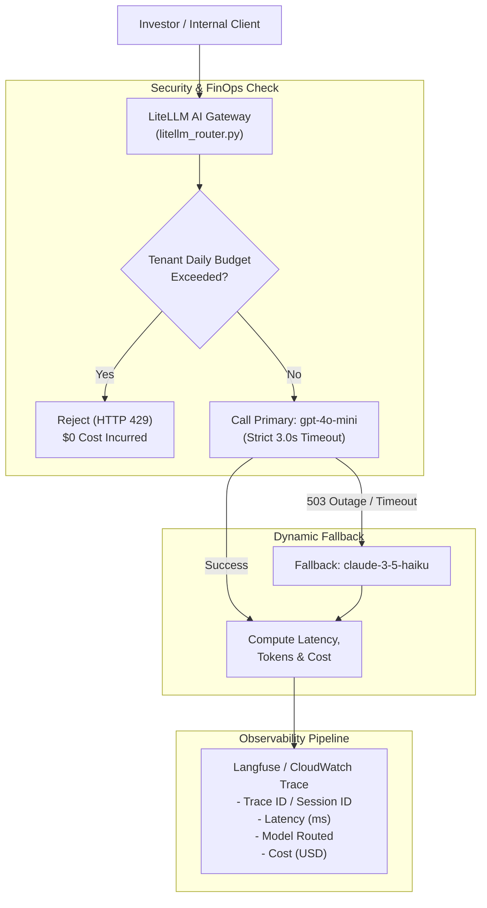

# Production LLM Observability & LiteLLM Gateway

> **Time Commitment:** Hour 4 of the 5-Hour Sprint  
> **Target Mastery:** Multi-provider LLM routing, automatic failover, latency tracking, token budgeting (FinOps), and Langfuse/OpenTelemetry observability.

---

## 📖 1. Why Company Platforms Need an AI Gateway

Directly calling `openai.OpenAI()` or `anthropic.Anthropic()` in production microservices creates critical enterprise risks:

1. **Vendor Lock-in & Outage Vulnerability:** If OpenAI experiences a 503 outage or rate limit (HTTP 429), your trading assistant or compliance pipeline crashes unless you have automated fallback to Anthropic Claude or AWS Bedrock.
2. **FinOps Risk (Runaway Costs):** Without centralized token budgeting, a single looping agent or malicious user can burn thousands of dollars in API credits in minutes.
3. **Regulatory Audit Compliance (BaFin):** Financial institutions must log every prompt, completion, token count, model version, and latency metric for auditability and compliance.

---

## 🏗️ 2. Architectural Diagram: The LiteLLM Gateway Pattern



---

## ⚡ 3. LiteLLM Core Features Explained

* **Unified API Format:** Call any model (OpenAI, Anthropic Claude, Google Gemini, AWS Bedrock, Mistral) using the exact same OpenAI-compatible input/output schema.
* **Automatic Fallbacks:** If `gpt-4o-mini` throws a rate-limit error or times out, LiteLLM automatically tries `claude-3-5-haiku` seamlessly behind the scenes.
* **Model Cooldowns:** If a provider repeatedly fails, LiteLLM temporarily marks that model as unhealthy for 60 seconds to avoid wasting connection timeouts.
* **Zero Vendor SDK Lock-in:** You can change backend model providers by modifying one line of configuration rather than refactoring application code.

---

## 📊 4. The 4 Essential LLM Observability Metrics

| Metric | What it measures | Target SLA in Fintech |
| :--- | :--- | :--- |
| **TTFT (Time to First Token)** | Time elapsed before the streaming response starts | `< 400 ms` |
| **P95 / P99 Latency** | 95th percentile total response duration | `< 2.5 seconds` |
| **Token Burn Rate** | Cumulative tokens consumed per tenant/hour | Hard budget capped |
| **Fallback Rate** | Percentage of requests diverted to secondary models | `< 0.5%` normal; alert if `> 5%` |

---

## 🛡️ 5. Security & BaFin Compliance for GenAI

* **PII Masking (GDPR):** Before sending user queries to external cloud LLMs, redact IBANs, German Tax IDs (Steuer-ID), names, and trade ticket amounts.
* **Prompt Injection Defenses:** Enforce system prompt boundaries and use structured JSON schemas (Pydantic / OpenAI Tool Calling) to prevent jailbreaks.
* **Immutable Audit Trail:** Store all model inputs, outputs, and model IDs with timestamps in append-only storage (e.g. S3 with object lock or CloudWatch logs).

---

## 🎤 6. Senior AI Engineer Interview Questions & Answers

### Q1: "How do you prevent vendor lock-in when building LLM applications?"
> **Winning Answer:**  
> *"We decouple application logic from model providers using an AI Gateway pattern with LiteLLM. Our microservices interact only with standardized interfaces. If OpenAI changes pricing, experiences downtime, or if an open-source model hosted on AWS Bedrock becomes more cost-effective, we switch or route traffic dynamically via configuration without rewriting backend prompts or parsing logic."*

### Q2: "How do you protect your production system from LLM rate limits and unexpected API outages?"
> **Winning Answer:**  
> *"We implement three layers of defense:  
> 1. **Prioritized Fallbacks:** Primary fast model (`gpt-4o-mini`), secondary fallback (`claude-3-5-haiku`), and tertiary on-premise/Bedrock fallback.  
> 2. **Circuit Breakers & Exponential Backoff:** Using jittered retries with strict timeouts (e.g., 2.5s) to ensure user requests don't hang.  
> 3. **Token Bucket Rate Limiting:** Enforcing client-side rate limits before making outbound API requests, paired with Redis caching for repetitive queries."*

### Q3: "What observability tools and telemetry standards do you use for GenAI?"
> **Winning Answer:**  
> *"We use OpenTelemetry and Langfuse to capture end-to-end distributed traces. Each LLM call is tagged with `trace_id`, `user_id`, `prompt_tokens`, `completion_tokens`, latency, and exact calculated USD cost. This allows us to detect model latency regression, track token burn rate across departments, and monitor prompt drift in real time."*

---

## 🧪 7. Running the Live Observability Simulation

Run the complete simulation locally without requiring paid API keys:

```bash
python sprint_projects/03_llm_observability/observability_demo.py
```
*(Tests healthy routing, simulated 503 outage failover, token budget cutoff, and outputs a valid Langfuse JSON telemetry payload!)*
